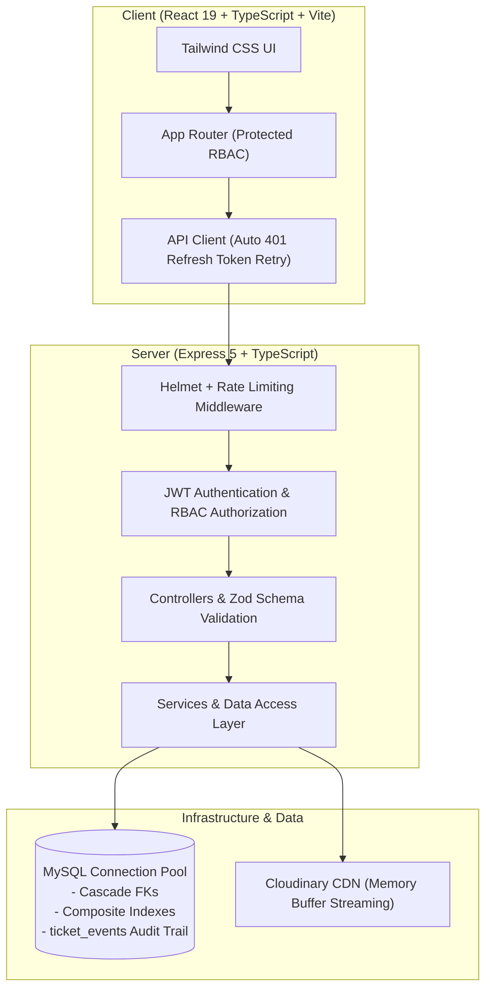

# RESOLVE — Role-Based Support Workspace

[](https://resolve-pink-eight.vercel.app/)
[](https://github.com/DikshJaswal/RESOLVE/actions/workflows/ci.yml)
[](https://www.typescriptlang.org/)
[](https://react.dev/)
[](https://expressjs.com/)
[](https://www.mysql.com/)
[](https://www.docker.com/)

**RESOLVE** is a production-ready, full-stack customer support ticketing workspace engineered with React 19, TypeScript, Express 5, and MySQL. It features granular multi-tenant Role-Based Access Control (RBAC), cryptographic refresh token rotation, append-only ticket audit trails, Cloudinary attachment streaming, and containerized deployment.

---

## ⚡ Instant Demo Credentials

The live deployment at **[resolve-pink-eight.vercel.app](https://resolve-pink-eight.vercel.app/)** includes 1-click login buttons for all roles:

| Role | Email | Password | Access Scope |
| :--- | :--- | :--- | :--- |
| **Admin** | `admin@resolve.com` | `Password123!` | Full system visibility, staff creation/activation, ticket assignment, categories |
| **Agent** | `agent@resolve.com` | `Password123!` | Unassigned ticket queue, assigned ticket triage, customer replies, priority updates |
| **Customer** | `customer@resolve.com` | `Password123!` | Submit support tickets, upload attachments, view own ticket timeline & replies |

---

## 🏛️ System Architecture



---

## ✨ Key Engineering Highlights

- **Multi-Tenant RBAC Security:** Strict tier isolation separating `CUSTOMER`, `AGENT`, and `ADMIN`. Handled at middleware level via `authorize(...)` and row-level ownership checks (`canAccessTicket`).
- **Cryptographic Refresh Token Rotation:** Issues short-lived access JWTs and saves SHA-256 hashed refresh tokens in MySQL. The client-side HTTP interceptor automatically negotiates a new access token on `401` without interrupting user workflow.
- **Relational Data Modeling:** Raw `mysql2/promise` connection pooling with parameterized queries to prevent SQL injection, composite indexing on high-frequency queries (`(user_id, is_read)`), and cascade delete integrity.
- **Append-Only Audit Trail:** Detailed timeline history table (`ticket_events`) tracking timestamped creation, status transitions, priority shifts, and staff assignments.
- **Defense-in-Depth:** Secure HTTP headers via `helmet`, endpoint rate-limiting on authentication routes via `express-rate-limit`, and runtime input coercion & validation using `zod`.
- **Cloud Attachment Pipeline:** Streaming upload to Cloudinary directly from Multer memory storage with 10MB file caps and strict MIME validation (PDFs, images, ZIP archives).
- **Multi-Stage Containerization:** Production-ready `Dockerfile` with multi-stage builds (`node:22-alpine`) separating TypeScript compilation from the lean runtime container.

---

## 📡 API Specification

| Method | Endpoint | Access | Description |
| :--- | :--- | :--- | :--- |
| `POST` | `/api/auth/register` | Public | Register new customer account |
| `POST` | `/api/auth/login` | Public | Authenticate user; returns JWT access & refresh tokens |
| `POST` | `/api/auth/refresh-token` | Public | Rotate and issue new access token |
| `POST` | `/api/auth/logout` | Authenticated | Revoke refresh token |
| `GET` | `/api/health` | Public | Healthcheck and database connectivity status |
| `GET` | `/api/dashboard/stats` | Authenticated | Role-filtered ticket metric aggregations |
| `GET` | `/api/tickets` | Authenticated | Paginated ticket list with status/priority filtering |
| `POST` | `/api/tickets` | Customer | Create support request |
| `GET` | `/api/tickets/:id` | Authenticated | Get ticket details, comments, and event audit history |
| `POST` | `/api/tickets/:id/assign` | Agent / Admin | Claim ticket or assign to active agent |
| `PATCH` | `/api/tickets/:id/status` | Agent / Admin | Update ticket workflow status |
| `PATCH` | `/api/tickets/:id/priority` | Agent / Admin | Update ticket urgency priority |
| `POST` | `/api/tickets/:id/comments` | Authenticated | Add conversation reply & trigger notifications |
| `POST` | `/api/tickets/:id/attachments`| Authenticated | Upload attachment to Cloudinary |
| `GET` | `/api/notifications` | Authenticated | Retrieve in-app notifications |
| `PATCH` | `/api/notifications/:id/read` | Authenticated | Mark notification as read |
| `GET` | `/api/users` | Admin | List all registered staff and customers |
| `POST` | `/api/users` | Admin | Create agent or administrator account |
| `PATCH` | `/api/users/:id/status` | Admin | Activate or deactivate staff member |

---

## 🛠️ Local Development Setup

### Prerequisites
- Node.js (v20+ recommended)
- MySQL instance (local or hosted like PlanetScale / Aiven)

### 1. Server Setup

```bash
cd server
npm install

# Copy environment template and populate MySQL credentials
cp .env.example .env

# Initialize database schema and migrations
npm run db:init
npm run db:migrate:active-users
npm run db:migrate:notifications
npm run db:seed

# Start development server
npm run dev
```
Server starts at `http://localhost:5000` (Healthcheck: `http://localhost:5000/api/health`).

### 2. Client Setup

```bash
cd ../client
npm install
cp .env.example .env
npm run dev
```
Client runs at `http://localhost:5173`.

---

## 🧪 Testing & Verification

The project includes unit validation tests and API integration tests using **Vitest** and **Supertest**:

```bash
cd server

# Run Vitest test suite
npm test

# Run build verification
npm run build
```

---

## 🐳 Docker Deployment

To build and run the production container locally:

```bash
cd server
docker build -t resolve-api .
docker run -p 5000:5000 --env-file .env resolve-api
```
